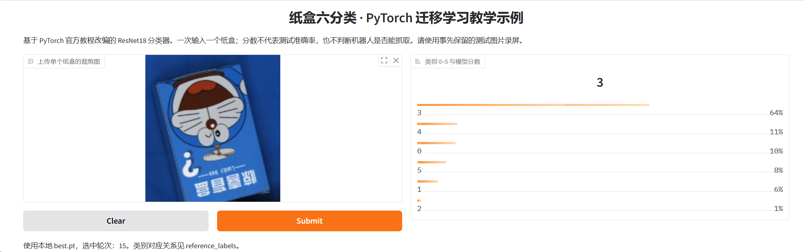
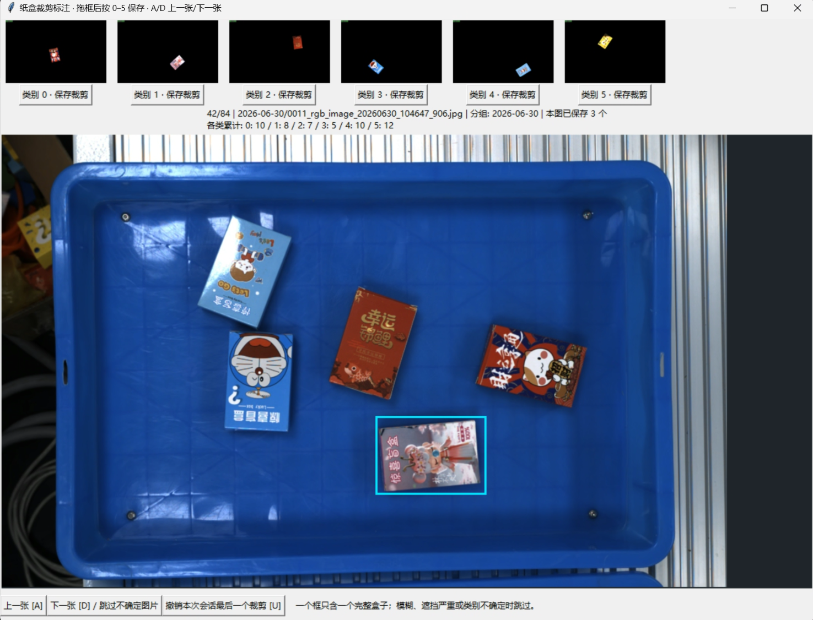

# paperbox-classifier

用实验室采集的纸盒图片练习一遍图像分类：人工裁剪、类别标注、按组划分数据、训练 ResNet18，再用本地网页查看预测。方法参考 [PyTorch 官方迁移学习教程](https://docs.pytorch.org/tutorials/beginner/transfer_learning_tutorial.html)。

输入是**单个纸盒的 RGB 裁剪图**，输出是类别 `0`～`5` 和模型分数。项目没有连接机器人，也不包含自动检测、实例分割、三维定位或抓取规划。



## 仓库提供什么

- 可运行的标注、训练、评估和预测代码。
- **84 张未标注原图**，覆盖 7 个采集日期，以及 6 张类别参考图。下载后自行标注。
- 一次已完成实验的配置、逐轮日志、曲线和测试报告，存放于 [`results/experiment01`](results/experiment01)。
- 参考权重在 [v1.0.0 Release](https://github.com/Futureppo/paperbox-classifier/releases/tag/v1.0.0) 下载，使用方法见 [权重说明](docs/WEIGHTS.md)。

**不提供本次实验的 `data`：52 张裁剪图、人工标注和固定划分均未公开。** 因此可以按代码重新做实验，也可以加载参考权重体验预测，但不能仅凭本仓库精确重建本次训练集或复测原来的 6 张测试图。重新标注后的数量、划分和结果可能不同。

代码使用 [BSD-3-Clause](LICENSE)。图片和数据使用 [CC BY-NC 4.0](DATA_LICENSE.md)，允许署名后的非商业使用。具体素材范围见 [来源说明](NOTICE.md)。

## 快速开始：Windows + NVIDIA 显卡

已完成的实验使用 Windows、Python 3.12、RTX 4060 Laptop 8GB 和 `torch 2.8.0+cu126`。安装 64 位 Python 3.12 时保留 Python Launcher 与 Tcl/Tk，安装可用的 NVIDIA 驱动。无需另装完整 CUDA Toolkit。

下载仓库并解压，在 `paperbox-classifier` 文件夹里打开 PowerShell：

```powershell
powershell -NoProfile -ExecutionPolicy Bypass -File .\setup_4060.ps1
```

脚本在当前项目创建 `.venv`，不会改动系统 Python。无需手动激活虚拟环境，后续命令直接调用其中的 Python。临时 `ExecutionPolicy Bypass` 不修改系统的永久策略。

普通 Python 依赖下载慢时，可指定清华 PyPI 镜像：

```powershell
powershell -NoProfile -ExecutionPolicy Bypass -File .\setup_4060.ps1 -PipIndex https://pypi.tuna.tsinghua.edu.cn/simple
```

`-PipIndex` 只影响普通依赖。CUDA 版 PyTorch 使用单独的官方源，下载量约 2.9GB；如有自己确认可用的 PyTorch 镜像，可通过 `-TorchIndex` 指定。安装失败后可以重跑脚本。CPU 安装、Linux 命令和常见报错见 [安装说明](docs/INSTALL.md)。

## 1. 检查原图并人工标注

```powershell
.\.venv\Scripts\python.exe check_data.py --sources source_frames
.\.venv\Scripts\python.exe annotate.py
```



窗口上方是类别参考图。拖框选中一个完整盒子，再按 `0`～`5` 保存。`A` / `D` 切换原图，`U` 撤销本次打开后最后保存的一张。**按下类别键时立即保存，可以随时关闭窗口。** 下次打开会恢复浏览位置。

每个框只包含一个盒子，保留完整盒面和少量边缘。模糊、严重遮挡或类别无法确认的图像跳过。输出在 `data/crops/` 和 `data/annotations.csv`。

每类至少覆盖 **3 个独立采集组**，否则无法让训练、验证、测试三个集合都包含该类。日期只是本数据采用的分组代理，同次摆放或近似画面不应为了凑组数而拆开。建议每类先积累约 30～60 个有效裁剪，并覆盖不同组、位置和方向，这不是准确率保证。

`reference_labels` 含类别答案，只用于对照，**不能混入训练、验证或测试数据**。类别对应与数据来源见 [数据说明](docs/DATASET.md)。

## 2. 固定训练、验证和测试划分

```powershell
.\.venv\Scripts\python.exe prepare_data.py
.\.venv\Scripts\python.exe check_data.py --data data/prepared
```

同组样本整体进入一个集合，三个集合均需覆盖六类。脚本尽量接近 70% / 15% / 15%，但组大小和类别分布会影响实际比例，**以输出数量为准**。`manifest.json` 保存样本来源、类别、分组、划分及 SHA-256。

已有输出目录不会覆盖。补充标注后可用 `prepare_data.py --out data/prepared_v2` 创建新版本，训练时同步指定 `--data data/prepared_v2`。

## 3. 训练模型

```powershell
# 可选：先用一轮验证训练入口，结果不用于正式评估
.\.venv\Scripts\python.exe train.py --epochs 1 --freeze-epochs 1 --out runs/smoke

# 正式实验
.\.venv\Scripts\python.exe train.py --epochs 20 --freeze-epochs 5 --out runs/experiment01
```

首次训练会下载约 45MB 的 ResNet18 ImageNet 预训练权重。模型使用 `224 × 224` 缩放补边输入，将最后一层改成六类输出。训练集增加随机旋转和轻微颜色变化，验证、测试不做随机增强。

| 阶段 | 参数更新 | 学习率 |
|---|---|---|
| 第 1～5 轮 | 冻结骨干和其 BatchNorm 统计，只训练分类头 | 0.001 |
| 第 6～20 轮 | 解冻整网，微调全部参数 | 0.0001 |

默认 batch size 32，CUDA 下开启混合精度。`best.pt` 只根据验证集准确率选择，同分保留较早轮次。输出包含配置、CSV/JSON 日志、曲线、最佳与最后一轮权重。`last.pt` 保存模型参数，但本版没有断点续训入口。

训练输出存在时改用新的 `--out`，例如 `runs/experiment02`。显存不足可降为 `--batch-size 16` 或 `8`。仅 CPU 时增加 `--device cpu`。

## 4. 评估自己的保留测试集

```powershell
.\.venv\Scripts\python.exe evaluate.py
```

默认读取自己训练的 `runs/experiment01/best.pt` 和 `data/prepared`，生成 `test_report/metrics.json`、`predictions.csv` 及混淆矩阵。程序校验数据指纹，防止在更换划分后仍使用旧权重复测。

自定义路径示例：

```powershell
.\.venv\Scripts\python.exe evaluate.py --checkpoint runs/experiment02/best.pt --data data/prepared_v2 --out runs/experiment02/test_report
```

测试集留到选定模型后评价，避免根据测试结果反复调参。**下载的参考权重不能与自己重新标注的数据一起复测原实验**，指纹不同时报错是预期行为。可以用它做单图预测。

## 5. 本地网页预测

```powershell
.\.venv\Scripts\python.exe app.py
```

浏览器会打开 `http://127.0.0.1:7860`。上传单个纸盒的裁剪图，查看六类分数，`Ctrl+C` 停止服务。只监听本机，默认不生成公网分享地址。端口占用时增加 `--port 7861`。

也可以使用命令行：

```powershell
.\.venv\Scripts\python.exe predict.py --image "单盒裁剪图.jpg" --out runs/prediction.json
```

模型分数是未经概率校准的 softmax 输出。整幅多盒图和未知物品仍可能获得高分，本版没有自动检测或未知类别拒识。

## 本次参考实验

| 项目 | 实际记录 |
|---|---|
| 样本总数 | 52 张人工单盒裁剪 |
| 训练 / 验证 / 测试 | 24 / 22 / 6 张 |
| 最佳轮次 | 第 15 轮 |
| 最佳验证准确率 | 18 / 22 = 81.8% |
| 保留测试结果 | 6 / 6 正确，每类仅 1 张，宏平均 F1 = 1.00 |


测试集只有 6 张，这次全对不足以估计复杂场景中的准确率，也不能说明机器人抓取成功率。详见 [实验记录与局限](docs/EXPERIMENT.md)。原始结果文件保留实际运行记录，没有为发布改写指标。

## 目录

```text
source_frames/       84 张未标注原图及索引，可重新标注
reference_labels/    类别 0～5 对照图，仅供参考
data/                用户自己生成，不随仓库发布
runs/                用户训练输出，不随仓库发布
results/experiment01/已完成参考实验的日志和报告
docs/                安装、数据、权重及结果说明
annotate.py          框选单盒并保存类别
prepare_data.py      按采集组划分数据
check_data.py        无需 PyTorch 的文件、哈希及划分检查
train.py             两阶段 ResNet18 迁移学习
evaluate.py          固定测试集评估
predict.py / app.py  命令行预测与本地网页
```

数据检查和测试无需显卡：

```powershell
.\.venv\Scripts\python.exe -m unittest discover -s tests -v
.\.venv\Scripts\python.exe scripts/verify_release.py
```

项目改编关系与许可见 [NOTICE.md](NOTICE.md)。贡献说明见 [CONTRIBUTING.md](CONTRIBUTING.md)。
