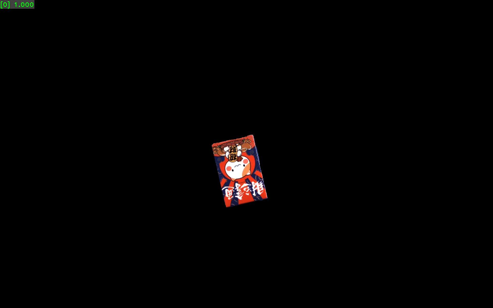
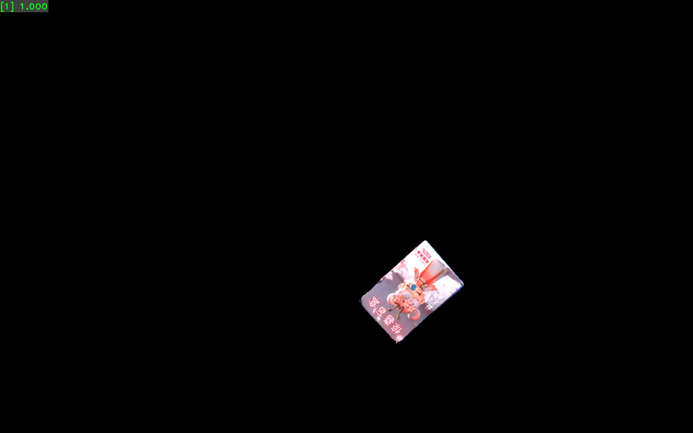
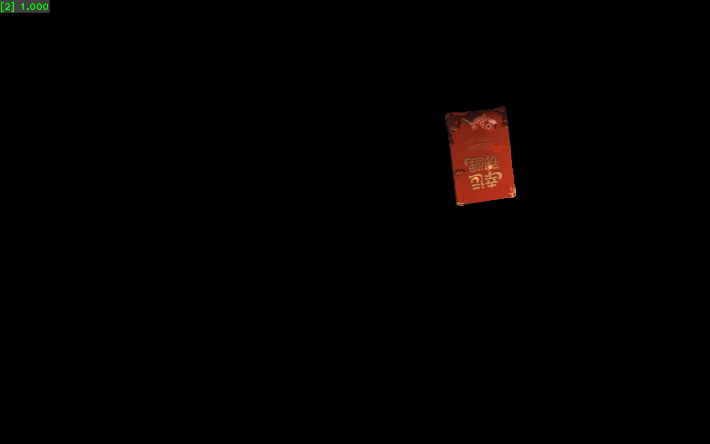
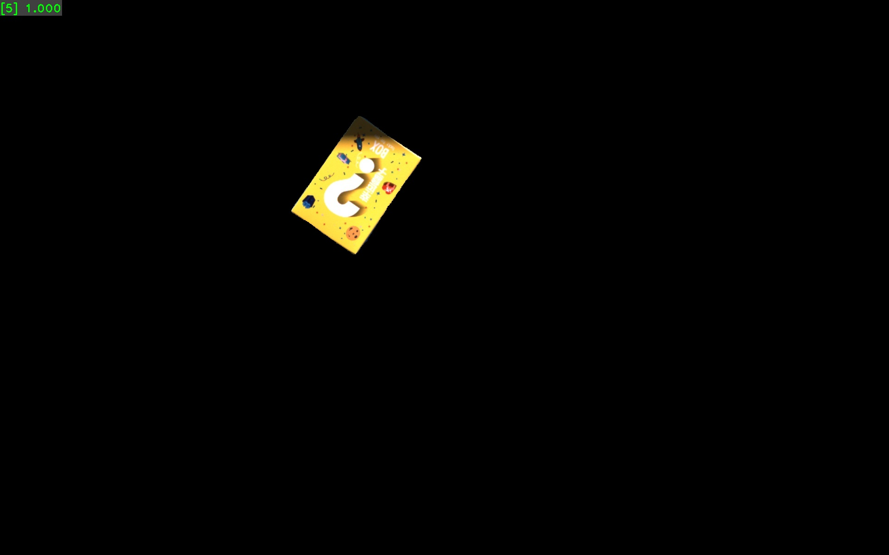

# 数据集说明

## 公开内容

公开的是供重新标注的原始素材，包含 84 张 JPG，每个日期抽取 12 张，共 7 个日期。它们是实验室采集的多目标纸盒场景，并未提供自动生成的类别标签。

| 采集日期 | 公开原图数 |
|---|---:|
| 2026-04-25 | 12 |
| 2026-06-05 | 12 |
| 2026-06-25 | 12 |
| 2026-06-30 | 12 |
| 2026-08-13 | 12 |
| 2026-09-08 | 12 |
| 2026-09-09 | 12 |
| 合计 | 84 |

原图从 1,128 张已有 JPG 中按日期分组，在排序后的文件位置上等距抽样，去除字节完全相同的图片。抽样不保证各类数量相等，也不保证拍摄的是不同实体盒子。详细统计见 [`sampling_report.json`](../source_frames/sampling_report.json)。

公开索引 `index.csv` 仅保留 `path`、`group` 和 `sha256`，移除了实验室工程路径和相机编号。图片字节未改动。`check_data.py --sources source_frames` 可核对文件与校验值。

## 六个类别

以原实验的数字标签为准，不根据外观猜品牌或商品名。以下图片只作对照，带有答案信息，不应作为训练、验证或测试图：

| 0 | 1 | 2 |
|---|---|---|
|  |  |  |

| 3 | 4 | 5 |
|---|---|---|
|  |  |  |

## 自己产生的标注

`annotate.py` 为每个裁剪保存 `path`、`label`、`group`、`source` 和原图坐标 `box`。裁剪文件位于 `data/crops/0`～`5`。工具保存的框只用于提取单盒图，本项目最终训练的是分类器。

默认 `group` 来源于原图索引中的采集日期。划分前需要根据实际采集关系检查分组：同次摆放、同段连续采集及高度相似画面应留在同组。不同日期不必然代表不同物体实例，公开数据不能证明模型对新商品或新实体盒子的泛化。

`prepare_data.py` 尝试接近 70% / 15% / 15%，同时满足组不交叉、三个集合都有六类的约束。有效组太少时会停止并要求补标注，最终数量取决于自己的标注。

## 未公开内容及影响

参考实验使用的 52 张裁剪、`annotations.csv` 和 `prepared/manifest.json` 不在仓库中。`results/experiment01` 是那次实验的真实记录，不能用自己重新标注的数据声称复现了同一个数据划分或同一组指标。

若希望自己的实验可精确复验，应另外保存原始标注、裁剪图、固定划分清单、代码版本、环境版本和权重。默认 `.gitignore` 忽略整个 `data/`，避免无意上传个人实验数据。

## 许可

公开图片及数据采用 [CC BY-NC 4.0](../DATA_LICENSE.md)，需要署名并限于非商业用途。对图片进行裁剪或重新标注后分享时，仍需遵守原图许可和归属说明。
