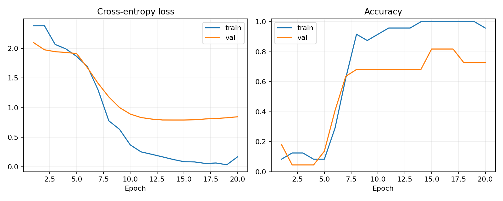
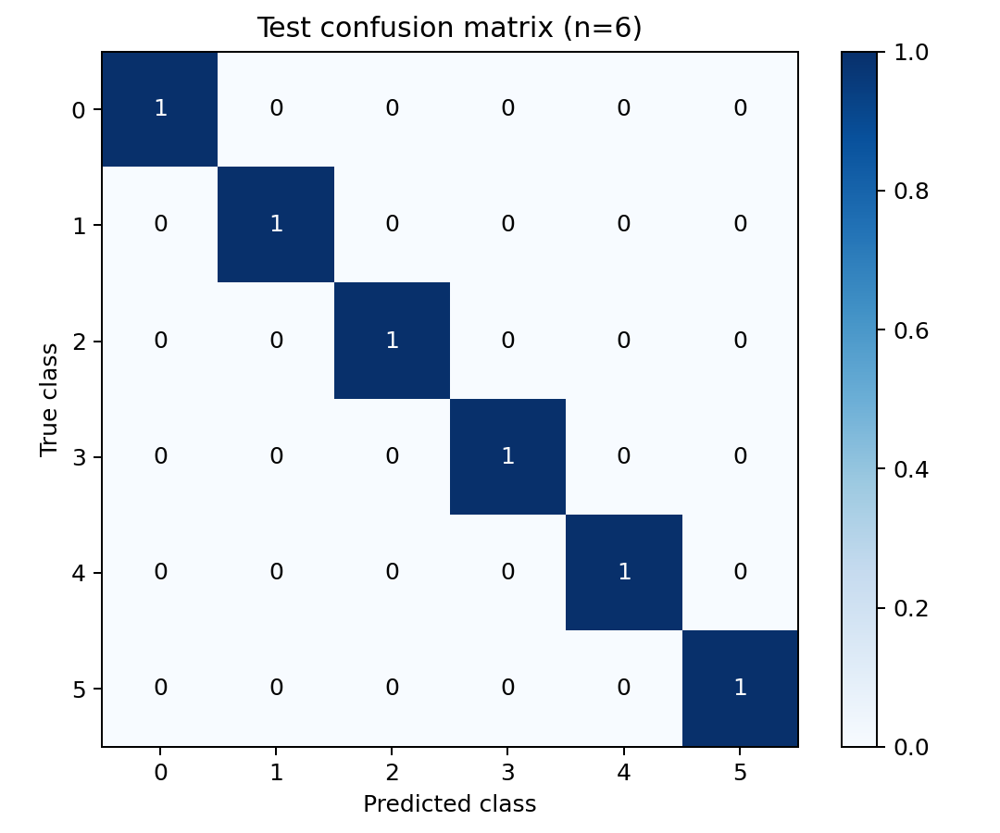

# 参考实验：experiment01

本页根据真实的 `config.json`、`history.csv`、`metrics.json` 和 `predictions.csv` 整理，所有原始记录位于 [`results/experiment01`](../results/experiment01)。

## 设置与数据

Windows、Python 3.12、RTX 4060 Laptop 8GB，PyTorch `2.8.0+cu126`。ResNet18 从 ImageNet 预训练权重开始，224×224 缩放补边，batch size 32，混合精度，随机种子 42。先训练分类头 5 轮，再微调全网 15 轮。

| 类别 | 训练 | 验证 | 测试 |
|---|---:|---:|---:|
| 0 | 5 | 4 | 1 |
| 1 | 3 | 4 | 1 |
| 2 | 5 | 1 | 1 |
| 3 | 1 | 3 | 1 |
| 4 | 5 | 4 | 1 |
| 5 | 5 | 6 | 1 |
| 总数 | 24 | 22 | 6 |

实际比例由按组划分约束和标注分布决定。原标注与划分未公开，因此这里只报告记录中可核对的数量，不列出无法确认的具体组分配。

## 训练与模型选择

第 15 轮验证准确率首次达到 **18/22 = 81.8%**。第 16、17 轮持平，代码按“严格高于历史最佳”更新，所以选中第 15 轮。第 20 轮验证准确率为 16/22 = 72.7%，最终测试采用 `best.pt`，而非最后一轮权重。

训练准确率曾达到 100%，而验证集表现存在差距。这提示需要补充样本、检查数据分布及泛化能力，不能只靠增加训练轮数解决。

## 保留测试集

测试集 **6 张、每类 1 张，6/6 分类正确，宏平均 F1 为 1.00**。由于每类仅有一张测试图，不能据此估计真实应用的稳定准确率。

| 真实 / 预测类别 | 最高类别分数 |
|---|---:|
| 0 / 0 | 98.91% |
| 1 / 1 | 81.34% |
| 2 / 2 | 94.48% |
| 3 / 3 | 63.62% |
| 4 / 4 | 76.45% |
| 5 / 5 | 98.90% |

这些是各图的 softmax 分数，未经概率校准，不能替代整个测试集上的分类准确率。界面将分数取整，所以类别 3、5 的截图显示约 64% 与 99%。

## 能说明什么

这次实验完成了从人工标注到训练、独立测试和本地网页预测的流程。样本量较小、类别不均衡，而且不同日期可能包含同一实体盒子，结论适用于这个小规模教学实验。

本项目只进行单盒 RGB 分类。实际机器人还要处理深度、坐标变换、抓取位姿、运动规划和吸附接触，分类结果不能换算为机器人抓取成功率。

记录中的 `elapsed_seconds` 是脚本内部的累计计时，未作为完整安装、权重下载和数据准备耗时，也未开展严格的硬件性能对比。

## 可复现范围

可以按公开代码重新标注和训练，也可以使用参考权重进行单图预测。原 52 张裁剪和固定划分没有公开，因此不能精确重建这次实验或用新划分复测原报告。已公开的模型配置、日志、指标和权重校验值可以相互核对。
